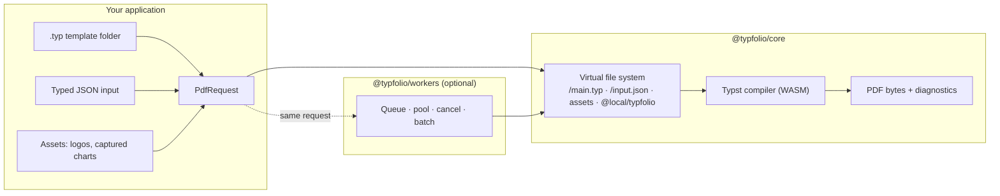

# Typfolio

**Browser-first PDF generation from Typst templates and JSON data.**

## Why this exists

We needed PDFs that screen readers can actually navigate. The JavaScript PDF libraries we tried draw text and boxes onto pages but emit no usable structure tree, so headings, tables and reading order are lost to assistive technology, and rendering HTML through a headless browser needs a server and still does not give PDF/UA output. Typst does: it writes tagged PDF natively and its exporter enforces PDF/UA-1 rules at compile time. We first ran it on a server, found it fast enough to compile a report in tens of milliseconds, and tried it in the browser as WebAssembly, where it turned out to be just as fast and removed the server entirely. What was missing then was the developer side: a typed contract between application data and template, editor completion for that data, and checks that catch a drifted template before a user does. Typfolio is that layer.

Typfolio compiles real, typeset, tagged PDFs inside the user's browser: your template is a `.typ` file, your data is a typed JSON object, and the result is PDF bytes you can preview, download or upload. No PDF service, no headless Chrome, no second copy of your business logic on a server. The same packages run in Node for batch jobs and tests.

```ts
import { createCompiler } from '@typfolio/core';

const compiler = await createCompiler({ wasm: wasmUrl, fonts: [fontBytes] });
const { bytes } = await compiler.compile({
  template: `
#let input = json("/input.json")
#set document(title: input.title)
= #input.title
#input.summary
`,
  input: { title: 'Quarterly report', summary: 'Application data goes here.' },
  pdf: { standards: ['ua-1'] },
});
```

## What it offers

**Native, accessible PDF, not a screenshot of a web page.** The document is produced by Typst's own PDF writer: real text, real fonts, real headings and tables in the structure tree. Ask for PDF/UA-1 or PDF/A and the exporter refuses output that breaks the standard, such as an image without alternative text. With a fixed creation timestamp the bytes are identical on every run, so a PDF can be snapshot-tested like any other build artifact.

**Fast enough that a server adds nothing.** On a laptop, a 50-page PDF/UA report with a table on every page compiles in about 220 ms, and a 100-page one in about 360 ms, with fresh data each time; one-page documents take 5–50 ms in the browser. Re-rendering the same data again is incremental and takes about 20 ms. The compiler is a 24 MB WebAssembly asset (6.5 MB with Brotli) that the browser downloads once and caches.

**The data never leaves the page.** The browser already holds the records, the charts and the user's session. Compiling there means nothing is uploaded, nothing is queued, and the feature keeps working offline.

**Templates are code with a typed contract.** `.typ` files live in your repo and are reviewed like code. `PdfRequest<Input>` types the data in TypeScript, the bundled `@local/typfolio` helper gives the editor field completion from your JSON Schema, and `@typfolio/core/dev-tools` compiles each template against minimal and full samples of that schema in CI, so a renamed field or an unguarded optional value fails the build, not the user.

**The UI stays responsive.** `@typfolio/workers` runs compilation in a bounded pool of web workers with queueing, timeouts and hard cancellation that terminates a running compile mid-way. Batches stream results as they finish, so generating hundreds of documents client-side is an ordinary loop.

**What the user sees goes into the document.** A live chart or any on-screen region can be captured (SVG, or PNG via html2canvas) and placed in the PDF as an asset with mandatory alt text.

**Pinned and reproducible.** The compiler is built from a pinned upstream revision with pinned toolchains, ships with a provenance file whose hashes the tests verify, loads fonts and the WASM only from where you say, and never touches the network during a compile.

## What Typfolio adds on top of the compiler

| Concern | What you get |
|---|---|
| Request model | `compile({ template, input, assets, pdf })`: template files, JSON input mounted at `/input.json`, binary assets, PDF options. Each job is isolated; nothing leaks between compiles |
| Typed input | `PdfRequest<Input>` types the JSON you pass; validation stays with your own tools (Zod or otherwise) |
| Editor completion | Templates import `@local/typfolio` and read `input(json.with("./report.schema.json"))`: at runtime that is the request input, in the editor it is a sample built from your JSON Schema, so `#data.` completes |
| Build-time checks | `@typfolio/core/dev-tools` compiles a template against a *minimal* and a *full* sample of its schema, catching unknown fields and unguarded optional data before runtime |
| Explicit resources | Fonts and the WASM are loaded from where you say; there is no implicit font CDN, no network access during compilation and no remote package downloads |
| Workers | Keeps the UI responsive: bounded pool of web workers, FIFO queue, per-job `AbortSignal`, timeouts, hard cancellation by terminating the worker mid-compile, worker replacement and streaming batches |
| React | `PdfProvider`, `usePdfCompilation`, `usePdfObjectUrl`: imperative, cancellation-safe state over either client |
| Browser capture | Turn a live chart (SVG) or DOM region (PNG via html2canvas) into a request asset with mandatory alt text, so what the user sees on screen lands in the PDF; only possible because compilation happens in the page |
| Reproducible build | The compiler is built from a pinned upstream revision with pinned Rust and wasm-bindgen, path-remapped, with a provenance file whose hashes the tests verify |

## How it works



The compiler never touches the host file system or the network. Everything a compile can see is what the request mounted, plus the bundled `@local/typfolio` helper package.

## Packages

| Package | Purpose |
|---|---|
| [`@typfolio/core`](./packages/core/README.md) | Compilation of template files, JSON input and assets into PDF bytes and diagnostics. Subpaths: `/capture`, `/capture/svg`, `/capture/dom` (browser asset capture) and `/dev-tools` (template checks), all kept out of the main entry |
| [`@typfolio/workers`](./packages/workers/README.md) | Module-worker execution: pools, queues, cancellation, timeouts, batches |
| [`@typfolio/react`](./packages/react/README.md) | Headless provider and hooks, plus the `CaptureRegion` marker component |
| [`@typfolio/wasm`](./packages/wasm/README.md) | The generated compiler binary, its bindings, the upstream licence and the build provenance; no hand-written code |

Core has no runtime dependency other than `@typfolio/wasm`. `html2canvas` (DOM capture) is an optional peer dependency and is never bundled unless you import the DOM adapter.

## Template authoring

```text
src/report/
  main.typ              #import "@local/typfolio:0.1.0": input
  partials/layout.typ   #let data = input(json.with("./report.schema.json"))
  report.schema.json    the application's JSON Schema; never sent at runtime
```

```ts
import { templateFromFiles, type PdfRequest } from '@typfolio/core';

const template = templateFromFiles(
  import.meta.glob('./report/**/*.typ', { query: '?raw', import: 'default', eager: true }),
);
const request: PdfRequest<ReportInput> = { template, input, pdf: { standards: ['ua-1'] } };
```

### Schema-driven completion and checks

The schema is yours: write it by hand or generate it from the validation library you already use. With Zod 4, one line produces it:

```ts
// scripts/write-schema.ts (the application's script; Typfolio has no Zod dependency)
import { z } from 'zod';
import { writeFile } from 'node:fs/promises';

export const Report = z.object({
  title: z.string().min(1),
  owner: z.string().nullable(),
  students: z.array(z.object({ name: z.string(), score: z.number().int().min(0).max(100) })),
});
export type ReportInput = z.infer<typeof Report>;

await writeFile('src/report/report.schema.json', JSON.stringify(z.toJSONSchema(Report), null, 2));
```

The template reads its input through the bundled helper:

```typ
#import "@local/typfolio:0.1.0": input
#let data = input(json.with("./report.schema.json"))

#set document(title: data.title)
= #data.title
#if data.owner != none [Prepared for #data.owner.]

#table(
  columns: 2,
  [*Student*], [*Score*],
  ..data.students.map(s => (s.name, str(s.score))).flatten(),
)
```

At runtime `input()` returns the request's JSON. In the editor nothing sets the runtime marker, so `input()` builds a sample from the schema and Tinymist completes from it: `#data.` offers `title`, `owner`, `students`; inside `data.students.map(s => ...)`, `s.` offers `name` and `score`. No sample file exists anywhere; the one editor setting is `"tinymist.typstExtraArgs": ["--package-path", "node_modules/@typfolio/core/typst-packages"]`.

The same schema checks the template in CI, with nothing written to disk:

```ts
import { createTemplateChecker } from '@typfolio/core/dev-tools';

const checker = await createTemplateChecker({ wasm, fonts });
const report = await checker.check(
  { files: { ...typFiles, 'report.schema.json': schemaText } },
  { pdf: { standards: ['ua-1'] } },   // modes default to ['minimal', 'full']
);
// minimal: required fields only, owner = null, students = []  → catches unguarded optional data
// full:    every field present, one student               → catches fields the schema no longer has
```

Path rules, the minimal-mode rules and the test-runner recipe are in [docs/template-authoring.md](./docs/template-authoring.md).

## How it compares

### Typst in JavaScript

Several projects run the Typst compiler from JavaScript. They solve different problems, and Typfolio builds on one of them. Versions are the published ones on 13 October 2026.

| | **Typfolio** (Typst 0.15.1) | [typst.ts](https://github.com/Myriad-Dreamin/typst.ts) (0.7.0) | [typst-wasm](https://github.com/typst-wasm/typst-wasm) (1.0.0) | [wasm-typst](https://github.com/LibrePaper/wasm-typst) (Typst 0.15.1) | [typst](https://github.com/typst-community/typst.js) npm (0.10.0-8) |
|---|---|---|---|---|---|
| What it is | Browser-first document-generation SDK: template + typed JSON → PDF | Typst toolkit: compiler, SVG/canvas/HTML renderer, framework components | Promise-based compiler for many runtimes | Raw WASM build of the compiler | Native Typst CLI binaries wrapped for Node |
| Runs in the browser | Yes, primary target | Yes | Yes | Yes | No |
| Runs in Node | Yes | Yes | Yes, plus Deno, Bun, Cloudflare Workers | Tooling only | Yes, plus Deno and Bun |
| Outputs | PDF | SVG, canvas, HTML, PDF | PDF, SVG, PNG, HTML | PDF, experimental HTML | Whatever the CLI writes (PDF, PNG, SVG) |
| Fonts | Supplied by the application | Downloaded from GitHub by default | Separate `@typst-wasm/fonts` package | Default fonts embedded in the binary | System and CLI fonts |
| Typst packages | Not supported; one bundled helper package | Fetched from the registry | Loader and cache hooks | Host downloads what the compile reports it needs | CLI behaviour |
| Network at compile time | None | Fonts and packages by default | Depends on loaders | None | None |
| Workers and cancellation | Built-in pool, hard cancel, batches | Compiler runs where you put it | Worker and JSPI backends | None | Processes |
| PDF standards | PDF/A-1 to A-4, PDF/UA-1, tags, timestamp; exporter-validated | No | Not documented | Not documented | CLI flags |
| Typed input and schema-driven editor completion | Yes | No | No | No | No |
| Reproducible, pinned build with verified provenance | Yes | Published packages | Published packages | Pinned to Typst 0.15.1 | Pinned binaries |
| Licence | Apache-2.0 | Apache-2.0 | MIT | MIT (binary includes Apache-2.0 Typst) | See project |
| Compiler asset, raw / Brotli (measured 13 Oct 2026, Brotli q11, 16 MB window) | 24.3 MB / 6.5 MB | 30.2 MB / 7.6 MB (`@myriaddreamin/typst-ts-web-compiler` 0.8.0-rc3) | 22.8 MB / 6.2 MB (`typst-wasm` 1.0.0) | 33.8 MB / 10.0 MB (release v0.3.1, fonts embedded) | Native binaries, not comparable |

Typfolio's compiler binary is built from a pinned revision of typst.ts's compiler crate (Typst 0.15.1). If you need SVG or canvas rendering, incremental preview or Typst package imports, typst.ts is the right tool. If you need one PDF per data record with a typed contract and no network access, that is what Typfolio is for.

### Other ways to make PDFs in a web application

| Approach | Layout quality | Where it runs | Accessibility | Trade-off |
|---|---|---|---|---|
| **Typfolio** | Full typesetter | In the user's browser, no service (Node too) | Tagged PDF, PDF/UA-1 and PDF/A on request | 24 MB compiler asset (6.5 MB with Brotli) to host and cache |
| HTML to PDF via headless Chrome (Puppeteer, Playwright) | Browser layout, good | A server process per job | Tagged PDF only with care; no PDF/UA validation | Needs a service and Chrome; slow and heavy per document |
| `@react-pdf/renderer` | Flexbox subset of CSS | Browser or Node | Limited tagging | Re-implements layout; tables and typography are basic |
| pdfmake, jsPDF, PDFKit | Manual layout primitives | Browser or Node | Mostly untagged | You write the page-breaking and text flow yourself |
| LaTeX in WASM | Full typesetter | Browser | Tagged PDF is experimental in LaTeX | Larger assets, slower, LaTeX templates |
| Commercial HTML/CSS formatters (Prince, PDFreactor) | Excellent | Server | Good | Licence cost, server-side only |

## Browser support and measurements

Browser-first means the browser matrix is the primary test target: a Playwright suite drives the smoke pages and the React example in Chromium, Firefox and WebKit. All five pages pass in each engine.

| | Chromium 156 | Firefox 157 | WebKit 27.2 |
|---|---|---|---|
| Compiler initialisation (page / module worker) | 37 ms / 19 ms | 223 ms / 211 ms | 122 ms / 72 ms |
| One-page compile, warm (page / worker) | 46 ms / 4 ms | 5 ms / 5 ms | 26 ms / 27 ms |
| Capture (SVG + html2canvas) and PDF/UA compile | pass | pass | pass |
| React example, direct and worker routes | pass | pass | pass |

Throughput on a realistic document (a report with a heading, five paragraphs and a 12-row table per section, PDF/UA-1, fresh data on every run so nothing is cached; Node on a laptop, median of five runs):

| Document | Pages | Output | Compile time |
|---|---|---|---|
| 5 sections | 12 | 76 kB | 74 ms |
| 25 sections | 52 | 328 kB | 218 ms |
| 50 sections | 102 | 647 kB | 358 ms |

Compiling the same data twice takes about 20 ms the second time, because the compiler caches unchanged work. The first compile after loading the module costs an extra 200–250 ms.

Sizes from the production Vite builds:

| Artifact | Size |
|---|---|
| Compiler WASM | 24,325,868 bytes; about 8.9 MB gzip, 6.5 MB Brotli |
| Worker application JavaScript (host + worker runtime) | 47.7 kB + 33.3 kB |
| Core-only library build | about 40 kB |

The WASM is emitted as a separate asset by every tested build, never inlined into JavaScript, so browsers cache it once. Numbers are from one machine with a local server and are illustrative, not benchmarks.

## Accessibility

Typfolio asks the compiler for tagged PDF by default and for PDF/UA-1 or PDF/A when requested. The exporter enforces the standard's structural rules at compile time, and the `dev-tools` check runs them against schema-derived samples in CI. Alternative text comes from your data, so a captured chart's `altText` should state its conclusion, not just that it is a chart. A tagged or PDF/UA-labelled file is not by itself proof of accessibility: run a validator such as [veraPDF](https://verapdf.org) on real documents and review reading order and alt text by hand.

## Documentation

- [docs/template-authoring.md](./docs/template-authoring.md): template folders, `@local/typfolio`, editor completion, build-time checks, typed requests, the folder loader.
- [docs/compiler-build.md](./docs/compiler-build.md): the pinned compiler build, rebuild and test commands, compatibility and limits.
- Package READMEs: [`core`](./packages/core/README.md), [`workers`](./packages/workers/README.md), [`react`](./packages/react/README.md), [`wasm`](./packages/wasm/README.md).

## Development

```sh
npm ci
```

Generate the compiler as described in [docs/compiler-build.md](./docs/compiler-build.md), then:

```sh
npm test               # builds, then runs the core, workers and React suites against the real compiler
npm run test:vite      # production builds of the Vite examples; checks the WASM stays a separate asset
npm run test:packed    # packs every package and verifies the packed boundaries
npm run test:browsers  # Playwright: smoke pages and React example in Chromium, Firefox and WebKit
npm run test:browser   # builds and serves the production worker smoke test for manual checks
```

Example dev servers (details in [examples/README.md](./examples/README.md)):

- `npm run dev:react`: routed Vite React app with direct-core and worker-backed pages over the same components.
- `npm run dev:pretext`: two [pretext](https://github.com/chenglou/pretext) demos rendered as PDFs; pretext lays out the text in the browser and Typst draws the result.
- `npm run dev:capture`: browser smoke page for the SVG and DOM capture adapters.

## Status

Typfolio is licensed under [Apache-2.0](./LICENSE) and is not yet published to npm. The compiler does not support Typst package imports beyond the bundled helper, page ranges or strict CSP without `unsafe-eval`; see [compatibility and limits](./docs/compiler-build.md#compatibility-and-limits).
