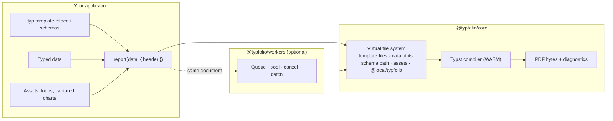

# Typfolio

**Schema-first, accessible PDF generation in the browser.** Typst compiled to WASM, driven by typed data, with the tools to check the result.

Typfolio turns a `.typ` template and a JSON object into a real, typeset, tagged PDF inside the user's browser. The Typst compiler runs as WASM in the page, so there is no PDF service, no headless Chrome and no second copy of your business logic on a server. The same packages run in Node for batch jobs and tests. [Try it in your browser](https://typfolio.kerematam.com/).

- **Structure comes from the markup.** `= Heading` is an H1, a `table` is a Table with TH cells, `image(alt:)` is a Figure: tagged PDF by default, PDF/UA-1 and PDF/A on request, compiled in one pass with nothing to patch afterwards ([what the compiler checks, and what it cannot](#accessibility)).
- **One schema, three jobs.** It types the template call, completes `#data.` in the editor and checks the template in CI, so a renamed field fails the build, not the user.
- **No PDF server.** The compiler is WASM in the page: nothing uploaded, nothing queued, works offline.
- **Fast.** A one-page document in 5–50 ms, a 50-page PDF/UA report in about 220 ms; a worker pool keeps the UI responsive.
- **A real typesetter.** Text flow, tables, fonts and page breaking from Typst, not boxes drawn on a canvas.
- **Checked, not assumed.** A panel shows the tags a screen reader gets, warnings name the structure a standard does not require but a reader needs, and veraPDF validates PDF/UA and PDF/A without Java, in the page, in a test or in CI ([how to check a document](#accessibility)).

```sh
npm install @typfolio/core @typfolio/typst-wasm zod
```

```typ
// main.typ
#import "@local/typfolio:0.1.0": input
#let data = input(json.with("./report.schema.json"))

#set document(title: data.title)
= #data.title
#data.summary
```

```ts
import { createCompiler, defineTemplate } from '@typfolio/core';
import wasmUrl from '@typfolio/typst-wasm/compiler.wasm?url'; // Vite; any URL to the asset works
import mainSource from './main.typ?raw';
import { z } from 'zod'; // or any Standard Schema library: Valibot, ArkType, …

const report = defineTemplate({
  files: { 'main.typ': mainSource },
  schema: z.object({ title: z.string(), summary: z.string() }),
  schemaPath: 'report.schema.json',
});

const compiler = await createCompiler({ wasm: wasmUrl, fonts: ['/fonts/report.otf'] });
const { bytes } = await compiler.compile(
  report({ title: 'Quarterly report', summary: 'Application data goes here.' }),
  { pdf: { standards: ['ua-1'] } },
);
// bytes is the PDF: preview it, download it or upload it
```

## Why this exists

We had to ship PDFs that meet accessibility standards: tagged, PDF/UA-1, and checked. Our first version was a server-side JavaScript pipeline. pdfmake drew the pages, and since none of the JavaScript PDF libraries we looked at builds the structure tree for you,[^1] a pdf-lib post-processor rewrote the bytes afterwards to add the tags. It parsed PDFKit's content streams line by line, held the whole PDF in memory, and could only ever produce paragraphs, never headings or tables, because which text is a heading is not in the bytes any more. After all that it still failed WCAG 1.3.1, and any upstream formatting change could break it silently. Structure has to be written where the meaning still exists, in the source, and compiled in one pass.

Typst does that: a heading is a heading, a table a table, and its PDF/UA-1 export refuses what breaks the standard's rules. We replaced the pipeline with a Typst compile on the server, and it was so fast that the server itself became the only overhead left: as WASM it compiles the same report in the browser in the same time, with nothing uploaded. What was missing was the developer side: a typed contract between data and template, editor completion for that data, and checks that catch a drifted template before a user does. Typfolio is that layer.

[^1]: Checked in October 2026 against the published code. pdfmake 0.3.12 passes `tagged` and `subset: "PDF/UA"` through to PDFKit and makes no structure calls of its own; its `headlineLevel` only drives page breaks and `headerRows` only repeats rows visually. pdf-lib 1.17.1 (its last release, from 2021), jsPDF 4.2.1 and `@react-pdf/renderer` 4.9.0 contain no tagging code; react-pdf's PDFKit fork carries the API, but the renderer never calls it ([diegomura/react-pdf#1790](https://github.com/diegomura/react-pdf/issues/1790), open since 2022). PDFKit 0.20.2 has a [tagging API](https://pdfkit.org/docs/accessibility.html), but you build every element and mark every artifact by hand, annotations and forms are not covered, and nothing validates the result.

## What you get

| Concern | What you get |
|---|---|
| Document model | `compile(report(data, { header: headerData }), { assets, pdf })`: a template called with its data and its partials' data, binary assets, PDF options. Each job is isolated; nothing leaks between compiles |
| Typed, checked data | `defineTemplate` types its call from its schema and checks the data with it before compiling: any Standard Schema (Zod, Valibot, ArkType), Typfolio has no validator of its own. A shared part with data of its own, such as a header, is a partial with its own schema, named once in the template |
| Editor completion | Templates import `@local/typfolio` and read `input(json.with("./report.schema.json"))`: at runtime that is the data, mounted at that path, in the editor it is a sample built from your JSON Schema there, so `#data.` completes |
| Build-time checks | `@typfolio/dev-tools` compiles a template against a *minimal* and a *full* sample of its schema, catching unknown fields and unguarded optional data before runtime, and on request the structure a screen reader needs, such as table header cells |
| Explicit resources | Fonts and the WASM are loaded from where you say; there is no implicit font CDN, no network access during compilation and no remote package downloads |
| Workers | Keeps the UI responsive: bounded pool of web workers, FIFO queue, per-job `AbortSignal`, timeouts, hard cancellation by terminating the worker mid-compile, worker replacement and streaming batches |
| React | `usePdf`: a PDF kept up to date with its data, like a query, with charts drawn at the PDF's size, over either client |
| Checking the result | `@typfolio/dev-tools` reads a compiled PDF's tags, reports missing structure, shows both in a panel in the page, and runs veraPDF (`@typfolio/verapdf-wasm`) from a test or the `typfolio-validate` command |
| Deterministic output | With a fixed creation timestamp the bytes are identical on every run, so a PDF can be snapshot-tested like any other build artifact |
| Browser capture | Turn a live chart (SVG) or DOM region (PNG via html2canvas) into an asset with mandatory alt text, so what the user sees on screen lands in the PDF; only possible because compilation happens in the page |
| Reproducible build | The compiler is built from a pinned upstream revision with pinned Rust and wasm-bindgen, path-remapped, with a provenance file whose hashes the tests verify |

## How it works



The compiler never touches the host file system or the network. Everything a compile can see is what the document and its options mounted, plus the bundled `@local/typfolio` helper package.

## Packages

| Package | Purpose |
|---|---|
| [`@typfolio/core`](./packages/core/README.md) | Templates and their typed data compiled into PDF bytes and diagnostics. Subpaths: `/capture`, `/capture/svg`, `/capture/dom` (browser asset capture), kept out of the main entry |
| [`@typfolio/dev-tools`](./packages/dev-tools/README.md) | Dev-time tools, installed as a devDependency and never needed at runtime: template checks against schema samples, `inspectPdf` and structure warnings (optional `pdfjs-dist` peer) to report a compiled PDF's structure for tests, a panel that shows a PDF's tags and veraPDF's verdict in the page, and `validatePdf` and the `typfolio-validate` command (optional `@typfolio/verapdf-wasm` peer) |
| [`@typfolio/workers`](./packages/workers/README.md) | Module-worker execution: pools, queues, cancellation, timeouts, batches |
| [`@typfolio/react`](./packages/react/README.md) | `usePdf`, with charts drawn at the PDF's size, and the `CaptureRegion` marker component |
| [`@typfolio/typst-wasm`](./packages/typst-wasm/README.md) | The generated compiler binary, its bindings, the upstream licence and the build provenance; no hand-written code |
| [`@typfolio/verapdf-wasm`](./packages/verapdf-wasm/README.md) | The [veraPDF](https://verapdf.org) validator built to WebAssembly: PDF/UA and PDF/A validation in Node and the browser without Java. Works on any PDF and has no dependency on the other packages. Its own licence, not Apache-2.0; see [Status](#status) |

Core has no runtime dependency other than `@typfolio/typst-wasm`. `html2canvas` (DOM capture) is an optional peer dependency and is never bundled unless you import the DOM adapter.

## Template authoring

```text
src/report/
  main.typ              #import "@local/typfolio:0.1.0": input
                        #let data = input(json.with("./report.schema.json"))
  partials/layout.typ
  report.schema.ts      the application's schema (Zod here)
  report.schema.json    its JSON Schema, generated; editor only, never sent at runtime
  template.ts           defineTemplate
```

```ts
// report.schema.ts: the application imports its schema library; Typfolio has none
import { z } from 'zod';

export const reportSchema = z.object({
  title: z.string().min(1),
  owner: z.string().nullable(),
  students: z.array(z.object({ name: z.string(), score: z.number().int().min(0).max(100) })),
});

// template.ts
import { defineTemplate } from '@typfolio/core';
import main from './main.typ?raw';
import layout from './partials/layout.typ?raw';

export const report = defineTemplate({
  entrypoint: 'report/main.typ',
  files: { 'report/main.typ': main, 'report/partials/layout.typ': layout },
  schema: reportSchema,
  schemaPath: 'report/report.schema.json',
});

// anywhere: typed by the schema, checked by it before compiling
await client.compile(report({ title: 'Q3', owner: null, students: [] }), { pdf: { standards: ['ua-1'] } });
```

A shared part with data of its own, such as a header, is a partial: `definePartial({ files, schema, schemaPath })`, listed once in the template (`partials: { header }`) and given its data by key, `report(data, { header: headerData })`.

### Schema-driven completion and checks

The JSON Schema file is generated from the same schema: `inputSchemaFiles(report)` from `@typfolio/dev-tools` returns every file (the template's and its partials'), by path, as JSON text, for a script to write and a test to compare.

The template reads its data through the bundled helper:

```typ
#import "@local/typfolio:0.1.0": input
#let data = input(json.with("./report.schema.json"))

#set document(title: data.title)
= #data.title
#if data.owner != none [Prepared for #data.owner.]

#table(
  columns: 2,
  [*Student*], [*Score*],
  ..data.students.map(s => (s.name, str(s.score))).flatten(),
)
```

At runtime `input()` returns the data, mounted at that path. In the editor nothing sets the runtime marker, so `input()` builds a sample from the schema and Tinymist completes from it: `#data.` offers `title`, `owner`, `students`; inside `data.students.map(s => ...)`, `s.` offers `name` and `score`. No sample file exists anywhere; the one editor setting is `"tinymist.typstExtraArgs": ["--package-path", "node_modules/@typfolio/core/typst-packages"]`.

The same schema checks the template in CI, with nothing written to disk:

```ts
import { createTemplateChecker } from '@typfolio/dev-tools'; // installed as a devDependency

const checker = await createTemplateChecker({ wasm, fonts });
const result = await checker.check(report, { pdf: { standards: ['ua-1'] } }); // modes default to ['minimal', 'full']
// minimal: required fields only, owner = null, students = []  → catches unguarded optional data
// full:    every field present, one student               → catches fields the schema no longer has
```

Path rules, the minimal-mode rules and the test-runner recipe are in [docs/template-authoring.md](./docs/template-authoring.md).

## Accessibility

Typfolio asks the compiler for tagged PDF by default and for PDF/UA-1 or PDF/A on request. The compiler tags what the template marks up: `= Heading` becomes an H1, `table` a Table with TH header cells, `figure(image(alt: ...))` a Figure with its alt text. A title set in a bigger face is a paragraph, not a heading. So write structure, and check for it. Three things check a document, and each catches what the one before lets through:

| | What it catches | Where it runs |
|---|---|---|
| **The compiler** | With PDF/UA-1: an image without alt text, headings that skip a level or start below H1. It refuses to write the file | Every compile; `createTemplateChecker` runs it on schema samples in CI |
| **Structure warnings** | What the standard accepts but a reader needs: a table without header cells, several pages without a heading | `checkStructure` from `@typfolio/dev-tools/pdf` in a test, or `structure: checkStructure` in the template check |
| **veraPDF** | The standard's rules checked on the finished file, by an independent validator: the same one, built to WebAssembly, so there is no Java to install | `validatePdf` from `@typfolio/dev-tools/validate` in a test, `typfolio-validate` in CI |

```sh
npm install --save-dev @typfolio/dev-tools @typfolio/verapdf-wasm
npx typfolio-validate --flavour auto out/*.pdf   # exits 1 when a file fails, so the build fails
```

```ts
import { checkStructure } from '@typfolio/dev-tools/pdf';
import { validatePdf } from '@typfolio/dev-tools/validate';

assert.deepEqual(await checkStructure(bytes), []);
assert.ok((await validatePdf(bytes, { flavour: 'ua1' })).compliant);
```

While you edit a template, `mountStructureDevtools` from `@typfolio/dev-tools/panel` shows all three in the page: the tags beside the page they tag, the warnings, and veraPDF's verdict on every compile. The [inspect demo](https://typfolio.kerematam.com/inspect) is that panel on a document whose structure you can take away, and the [validate page](https://typfolio.kerematam.com/validate) runs veraPDF on any PDF you drop on it.

**A pass is not proof.** All three check that the tags present are well formed, not that the content has the tags it needs: bold text in place of a heading passes every one of them on a one-page document. Run the checks on documents compiled from real data, since a schema sample is usually one page and cannot show that six pages have no heading; a test can also require that the headings match the outline the data implies. Alternative text comes from your data, so a captured chart's `altText` should state its conclusion, not just that it is a chart. Reading order and alt text still need a person, and a tagged or PDF/UA-labelled file is not by itself an accessible one.

## How it compares, and how fast it is

If you need SVG or canvas rendering, incremental preview or Typst package imports, [typst.ts](https://github.com/Myriad-Dreamin/typst.ts) is the right tool. If you need one PDF per data record with a typed contract, structure you can check and no network access, that is what Typfolio is for. [docs/comparison.md](./docs/comparison.md) compares it with the other Typst builds for JavaScript and with headless Chrome, react-pdf, pdfmake and others.

On a laptop a 50-page PDF/UA report compiles in about 220 ms and a one-page document in 5–50 ms; the compiler is a 24 MB WASM asset (6.4 MB with Brotli) that the browser downloads once. It is tested in Chromium, Firefox and WebKit. The tables are in [docs/measurements.md](./docs/measurements.md).

## Documentation

- [docs/template-authoring.md](./docs/template-authoring.md): template folders, `@local/typfolio`, templates with partials, editor completion, build-time checks, typed calls, loading a folder.
- [docs/errors.md](./docs/errors.md): error and diagnostic codes, and what to do about each.
- [docs/comparison.md](./docs/comparison.md) and [docs/measurements.md](./docs/measurements.md): other ways to make PDFs, browser support, compile times and sizes.
- [docs/compiler-build.md](./docs/compiler-build.md): the pinned compiler build, rebuild and test commands, compatibility and limits.
- [docs/verapdf-build.md](./docs/verapdf-build.md): how the validator is built to WebAssembly, and how it is checked against veraPDF on the JVM.
- Package READMEs: [`core`](./packages/core/README.md), [`dev-tools`](./packages/dev-tools/README.md), [`workers`](./packages/workers/README.md), [`react`](./packages/react/README.md), [`typst-wasm`](./packages/typst-wasm/README.md), [`verapdf-wasm`](./packages/verapdf-wasm/README.md).

## Development

See [CONTRIBUTING.md](./CONTRIBUTING.md) for setup, the test commands, project rules and the sign-off every commit needs.

```sh
npm ci
```

Development needs Node 22.18 or newer: the scripts in `tools/` are TypeScript that Node runs directly, and `npm run build` type-checks them together with the examples.

Generate the compiler as described in [docs/compiler-build.md](./docs/compiler-build.md), then:

```sh
npm test               # builds, then runs the core, workers and React suites against the real compiler
npm run test:vite      # production builds of the Vite examples; checks the WASM stays a separate asset
npm run test:packed    # packs every package and verifies the packed boundaries
npm run test:browsers  # Playwright: smoke pages and React example in Chromium, Firefox and WebKit
npm run test:browser   # builds and serves the production worker smoke test for manual checks
```

Example dev servers (details in [examples/README.md](./examples/README.md)):

- `npm run dev:react`: routed Vite React app with direct-core and worker-backed pages over the same components, and a Charts page that draws charts for the PDF with `useRenderedAssets`.
- `npm run dev:site`: the [site](https://typfolio.kerematam.com/): an overview, the worker batch benchmark, two [pretext](https://github.com/chenglou/pretext) demos rendered as live PDFs, `/inspect` (a compiled document in the tags panel) and `/validate` (veraPDF on PDFs you drop on it). The last two use the validator when it has been built (`npm run build:verapdf`).
- `npm run dev:capture`: browser smoke page for the SVG and DOM capture adapters.

## Status

Typfolio is licensed under [Apache-2.0](./LICENSE), with one exception: `@typfolio/verapdf-wasm` carries veraPDF (MPL-2.0) and a runtime under the Oracle GraalVM Free Terms and Conditions, which allow free use, including in CI, but restrict shipping it inside a paid product; read [its licence](./packages/verapdf-wasm/LICENSE) before you redistribute it. Nothing else depends on it. The packages are published to npm as `@typfolio/*`; they are pre-1.0, so minor versions can still change the API. The compiler does not support Typst package imports beyond the bundled helper, page ranges or strict CSP without `unsafe-eval`; see [compatibility and limits](./docs/compiler-build.md#compatibility-and-limits).
